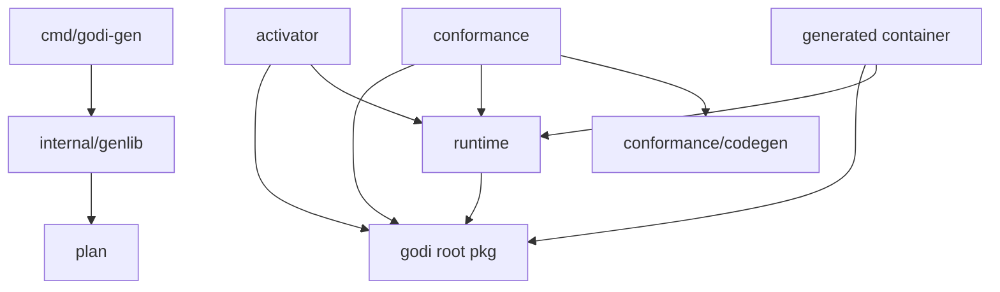
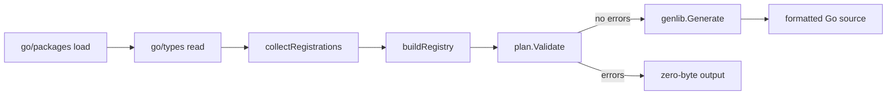

# godi — Architecture

## Overview

godi's main resolution path is **B2 codegen with direct wiring**: a static
analyzer reads registration type facts and emits a plain-Go container whose
constructor calls are wired field to field, with no reflective construction. Two
providers exist, both derived from the *same* registration source (AD-14):

- **Runtime provider** — a reflect-based oracle that resolves dynamically. It is
  the semantic reference implementation the generated code is diffed against.
- **Codegen provider** — the emitted container. It is the production path and
  carries zero reflective construction on its main flow.

Reflection is confined to a **three-tier strategy** (AD-13): direct wiring on the
main path, `reflect.Type` dispatch inside the runtime oracle, and
`reflect.Value.Call` only inside the activator.

## Package Dependency Topology

The generated container never depends on the generator — dependencies flow one
way (AD-2).

## Generation Pipeline

`cmd/godi-gen` loads the registration package with `go/packages`, reads type facts
from `go/types`, collects the static-marker calls, builds a `plan.Registry`, runs
the validation gate, and — only if validation is clean — calls `genlib.Generate`
to emit formatted Go (AD-3).

## Dual Provider Design

**Runtime provider** (`runtime/provider.go`): a `Builder` accumulates registrations
into `reflect.Type`-keyed factory maps; `Build()` produces a root/scope pair.
Instances are materialized lazily with cycle detection, and the disposer tracks
what needs releasing.

**Codegen provider** (`internal/genlib`): consumes a `plan.Registry` and emits a
`Root` struct with one field per service. Resolution is a `type switch` on
`reflect.TypeFor[T]()`, so `GetService` dispatches without constructing anything
reflectively.

Both honor the same `Provider` contract, so the conformance suite runs one set of
cases against both and asserts identical observable results (AD-15).

## Provider Interface & Miss Semantics

The seven-method face is pinned by AD-16 (revised 6 → 7 in Story 3.4 with the
addition of `IsKeyedService`):

`GetService`, `IsService`, `IsKeyedService`, `GetKeyedService`,
`GetKeyedServices`, `CreateScope`, `Close`.

Miss semantics are part of the contract: `GetService` / `GetKeyedService` /
`GetKeyedServices` on an unregistered lookup return **nil, never a panic**. The
pure queries `IsService` / `IsKeyedService` are total and never panic. Resolving
after `Close`, however, panics with the shared sentinel `ErrProviderClosed`,
matchable via `errors.Is`.

## Three-Tier Construction (AD-13)

| Tier | Mechanism | Where |
| --- | --- | --- |
| A | Direct wiring — literal constructor calls, no reflection | generated container main path |
| B | `reflect.Type` dispatch over factory maps | runtime oracle |
| C | `reflect.Value.Call` — the only reflective construction point | `activator.CreateInstance[T]` |

## Validation Gate

`plan.Registry.Validate()` aggregates all violations into a `[]error` in a single
pass (not fail-on-first). It rejects: duplicate service names, reserved names that
collide with `Provider` methods, missing dependencies, captive dependencies
(singleton depending on a shorter lifetime), and circular dependencies. A non-empty
result forces zero-byte generator output (AD-3).

## Disposer Pattern

`runtime.Disposer` releases in **LIFO** order via `Track` / `TrackAsync` /
`CloseAll` / `CloseAllAsync`. Disposability is auto-detected statically:
`io.Closer` via `Track`, `godi.AsyncDisposable` via `TrackAsync` (AD-11).
Ownership follows AD-12: **transient disposables are tracked by the scope that
created them; singletons are tracked only by the root.** Generated containers
consume the exported disposer directly.

## Keyed Services

The key type is `any` (AD-17), not `string`. A `nil` key routes to the unkeyed
namespace (`IsKeyedService(t, nil) == IsService(t)`). The `AnyKey` sentinel is
three-state: `GetKeyedService(AnyKey)` panics, `GetKeyedServices(AnyKey)` returns
all keyed instances in registration order, and `IsKeyedService(AnyKey)` returns
`false`. `AnyKey` is rejected as a registration key by both providers — a .NET
catch-all registration has no Go mechanism (a factory cannot receive a resolve-time
key), which is a deliberate mechanism wall.

## Open Generic Closed Materialization

Open generics use **explicit closed registration** — there is no runtime
`MakeGenericType` (AD-4 / AD-10). The generator materializes each closed instance
via a per-service helper (Mechanism A): `types.Instantiate` instantiates the
constructor signature so the concrete dependencies are read, template
`*types.TypeParam` markers are skipped, and the type arguments are folded into a
sanitized `serviceName` for disambiguation. Constraint satisfaction is guaranteed
by the Go type system.

## AsyncDisposable

`AsyncDisposable` is a structural, opt-in interface — `CloseAsync(ctx context.Context) error`
— the asymmetric-name counterpart of `io.Closer` (a Go type cannot carry two
`Close` methods). It is discovered by type assertion and is **not** part of the
`Provider` face. A service implementing both `io.Closer` and `AsyncDisposable`
prefers async release. `AsyncScope` wraps a `Scope` and smart-delegates:
`Close()` always forwards synchronously, while `CloseAsync()` prefers the wrapped
scope's async release.

## Architecture Decisions

| ID | Name | Description |
| --- | --- | --- |
| AD-1 | Codegen main architecture | B2 codegen main path; lifetime = instance storage location |
| AD-2 | Single emission path | Sole code-emission via `genlib.Generate`; unidirectional deps |
| AD-3 | Validation gate | Non-empty `Validate` → zero-byte output |
| AD-4 | Open generics explicit | Explicit closed registration; no `MakeGenericType` |
| AD-5 | Non-generic Provider | Interface methods cannot declare type params; typed API is free functions |
| AD-6 | Engine-parameterized tests | Take the Runtime engine only |
| AD-7 | Generator reads type facts | Static analysis; never executes user code |
| AD-8 | Constructor discovery | Strict `New{Impl}` naming (Form A) |
| AD-9 | Best-match selection | Multi-constructor best-match only in the activator |
| AD-10 | Open generics closure | Explicit closure; constraints guaranteed by Go type system |
| AD-11 | Disposable auto-detection | Detected via `types.Implements` |
| AD-12 | Disposable ownership | Transient tracked by scope; singleton only by root |
| AD-13 | Zero-reflective construction | No `reflect.New` / `Value.Call` on main path |
| AD-14 | Dual provider, one source | Both providers derived from the same DSL registration |
| AD-15 | 116-green | Runtime green + codegen coverage + cross-provider diff equivalence |
| AD-16 | Pinned Provider face | Seven-method interface (6 → 7 in Story 3.4) |
| AD-17 | Key semantics | Key type = `any`; `AnyKey` three-state; `nil` key = unkeyed |
