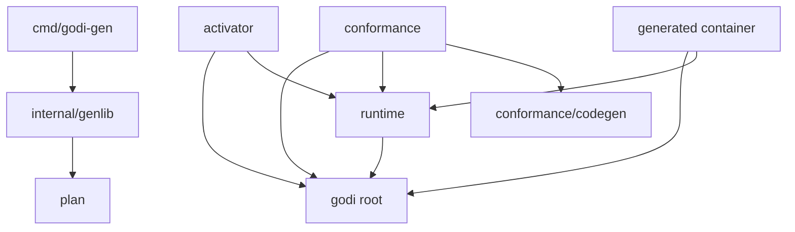

# godi — Project Overview

## Introduction

`godi` is a compile-time dependency injection container for Go, ported from the
semantics of the .NET `Microsoft.Extensions.DependencyInjection` stack (baseline
.NET 10, v10.0.9). It gives Go programs the familiar three-lifetime DI model —
singleton, scoped, transient — plus keyed services, disposable lifecycle
management, and open-generic resolution, **without paying a reflection tax on the
main resolution path**.

The value proposition is that godi's primary architecture is **B2 codegen with
direct wiring**: a static analyzer reads your registration file's type facts and
emits a plain-Go container whose constructor calls are wired directly, field to
field, with zero reflective construction. The runtime provider (a reflect-based
oracle) exists alongside it to prove — case by case — that the generated
container behaves identically to a dynamically resolved one. You register
services once; both providers are derived from that single source.

Because Go interface methods cannot declare type parameters, the ergonomic typed
API (`Get[T]`, `GetRequired[T]`, ...) lives as **free generic functions** over a
deliberately non-generic `Provider` interface, rather than as methods on it.

## Technology Stack

| Component | Version / Choice | Notes |
| --- | --- | --- |
| Go | 1.27 | `go.mod` `go 1.27`; unlocks method-level type parameters (AD-5) |
| Toolchain pin | go 1.27.0 | `mise.toml`; GA shipped 2026-08-19, pinned to the then-current stable patch |
| golang.org/x/tools | v0.49.0 | sole external dep; `go/packages` for static analysis (NFR6) |
| golang.org/x/mod | v0.39.0 | indirect dep of x/tools |
| golang.org/x/sync | v0.22.0 | indirect dep of x/tools |
| Baseline semantics | .NET 10, v10.0.9 | the conformance corpus is ported from this release |
| Test framework | stdlib only | no testify; assertions are thin wrappers over `testing.TB` |
| Module path | `github.com/gonewx/godi` | package `godi` sits at the module root |

## Nine Capabilities

| ID | Capability |
| --- | --- |
| CAP-1 | Three lifetimes (singleton / scoped / transient) |
| CAP-2 | Constructor injection with direct wiring |
| CAP-3 | Scopes (child resolution scopes, nested) |
| CAP-4 | Multiple implementations of one service type (enumerable resolution) |
| CAP-5 | Keyed services |
| CAP-6 | Service-existence queries (`IsService` / `IsKeyedService`) |
| CAP-7 | Disposable lifecycle (sync + async, LIFO release) |
| CAP-8 | Open-generic services (explicit closed materialization) |
| CAP-9 | Activator utilities (best-match reflective construction) |

## Package Structure

| Package | Responsibility |
| --- | --- |
| `godi` (root) | DSL markers, `Provider`/`Scope` interfaces, free generic resolution functions, `AnyKey`, async contracts |
| `plan` | Registration model (`Registry`, `Service`, `Lifetime`), validation gate, topological sort |
| `internal/genlib` | Sole code-emission path — `Generate()` and all `emit*` helpers |
| `cmd/godi-gen` | Static-analysis CLI: `go/packages` load → `go/types` read → `genlib.Generate` |
| `runtime` | Reflect-based provider oracle + disposer (Builder, root/scope, LIFO release) |
| `activator` | Tier C reflective construction (`CreateInstance[T]`, best-match selection) |
| `conformance` | Dual-provider parameterized spec suite, ported fakes, pre-generated container |

## Package Dependency Diagram



The generated container depends only on `godi` and `runtime` — never on the
generator (AD-2, unidirectional dependencies).

## DSL Registration Overview

Registration functions are **pure static markers** (AD-7): they are read by static
analysis and never executed. Two forms exist per lifetime:

- **Form A** (primary, AD-8) — maps interface `I` to implementation `Impl`; the
  generator discovers the strict `New{Impl}` constructor and wires its
  dependencies directly.
- **Form B** (escape hatch) — supplies a `func(Provider) I` factory whose argument
  expression is inlined. Because Go forbids generic-function overloading, form B
  takes a distinct name (`Add{Lifetime}Factory`, D-4).

| Lifetime | Form A (unkeyed) | Form B (unkeyed) | Keyed (Form A / Form B) |
| --- | --- | --- | --- |
| Singleton | `AddSingleton[I,Impl]` | `AddSingletonFactory[I]` | `AddKeyedSingleton` / `AddKeyedSingletonFactory` |
| Scoped | `AddScoped[I,Impl]` | `AddScopedFactory[I]` | `AddKeyedScoped` / `AddKeyedScopedFactory` |
| Transient | `AddTransient[I,Impl]` | `AddTransientFactory[I]` | `AddKeyedTransient` / `AddKeyedTransientFactory` |

## Provider Interface & Free Generic Functions

`Provider` is deliberately **non-generic** — an interface method may not declare
type parameters (AD-5). Its seven-method face is pinned by AD-16:

| Method | Purpose |
| --- | --- |
| `GetService(t reflect.Type) any` | resolve by type; miss returns `nil` (never panic) |
| `IsService(t reflect.Type) bool` | pure existence query |
| `IsKeyedService(t reflect.Type, key any) bool` | keyed existence query; `AnyKey` returns `false`, never panics |
| `GetKeyedService(t reflect.Type, key any) any` | resolve by (type, key); `nil` key routes to unkeyed |
| `GetKeyedServices(t reflect.Type, key any) []any` | enumerate (type, key) in registration order |
| `CreateScope() Scope` | open a child resolution scope |
| `Close() error` | idempotent release of owned disposables |

Six free generic functions layer typed ergonomics over that face:

| Function | Miss behavior |
| --- | --- |
| `Get[T](p) (T, bool)` | `(zero, false)` |
| `GetRequired[T](p) T` | panics with a naming error |
| `GetServices[T](p) []T` | empty non-nil slice |
| `GetKeyed[T](p, key) (T, bool)` | `(zero, false)` |
| `GetRequiredKeyed[T](p, key) T` | panics with a naming error |
| `GetKeyedServices[T](p, key) []T` | empty non-nil slice |

`AnyKey` is a **query-only sentinel**: `GetKeyedService(AnyKey)` panics,
`GetKeyedServices(AnyKey)` returns all keyed services for the type, and
`IsKeyedService(AnyKey)` returns `false`. It is never valid as a registration key
(AD-17).

## Quick Start

Declare services in a registration file using DSL markers — the generator
reads them statically, never executing user code:

```go
package myapp

import "github.com/gonewx/godi"

//go:generate godi-gen -pkg myapp -out container_gen.go .

func register() {
    var r godi.Registry

    godi.AddSingleton[Clock, SystemClock](&r)        // form A: wires NewSystemClock
    godi.AddScoped[Repo, SQLRepo](&r)                // form A: wires NewSQLRepo(Clock)
    godi.AddTransientFactory[Logger](&r, func(p godi.Provider) Logger {
        return NewLogger(godi.GetRequired[Clock](p)) // form B: inlined factory
    })
}
```

After `go generate ./...` emits `container_gen.go`, resolve services from the
generated container:

```go
root, err := myapp.NewRoot()
if err != nil {
    return err
}
defer root.Close()

clock := godi.GetRequired[Clock](root)

scope := root.CreateScope()
defer scope.Close()
repo := godi.GetRequired[Repo](scope)
```
