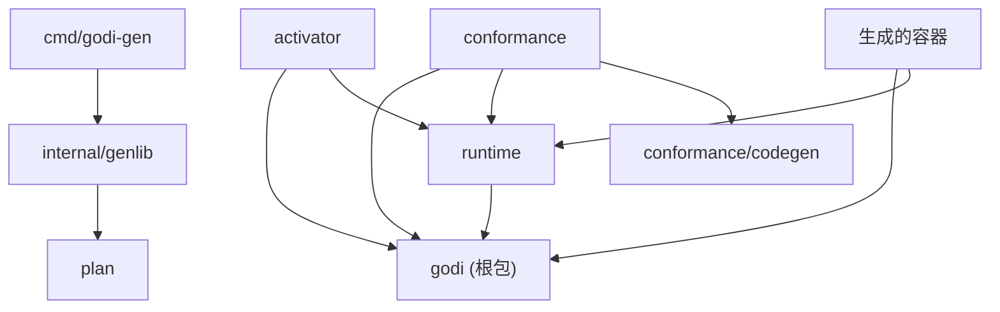
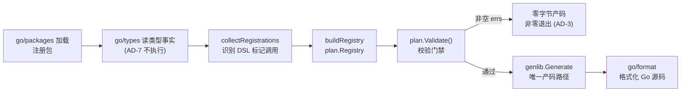

# godi 架构

## 架构总览

godi 的主架构是 **B2 codegen + 直接装配**：generator 在构建期把 DSL 注册源静态
转换成一份完整的 Go 容器代码，容器用类型化字段存放实例、以 `Ctor` 直接调用构造，
主路径不出现反射式构造（AD-1 / AD-13）。

围绕这条主路径有三个支柱：

- **双 Provider**：同一份 DSL 注册源派生出「运行时反射 Provider」（`runtime` 包，
  预言机/oracle）与「代码生成 Provider」（`internal/genlib` 产出），二者在同一
  `Provider` 契约下产生逐位等价的可观察行为（AD-14 / AD-15）。
- **三层反射策略**：Tier A 直接装配（主路径，零反射构造）；Tier B 用
  `reflect.Type` 仅作查询/派发键；Tier C `reflect.Value.Call` 仅存在于独立的
  `activator` 包（AD-13）。
- **静态标记 DSL**：注册函数是纯静态标记（AD-7），generator 只读类型事实、从不
  执行用户代码。

## 包依赖拓扑

关键单向约束（AD-2）：产码路径 `cmd/godi-gen → internal/genlib → plan` 是唯一
产码方向；**生成的容器只依赖 `godi` 与 `runtime`，永不反向依赖 generator**。

## 生成管线流程

generator 按包路径（`github.com/gonewx/godi`）+ 函数名双重匹配 DSL 标记，避免误读
同名函数；形态 B 的工厂参数以 `go/ast` 源码文本读取并内联。

## 双 Provider 设计

**运行时 Provider（`runtime`）**——预言机，反射驱动：

- `Builder → Build() → root/scope`：注册被物化为一组以 `reflect.Type` 为键的工厂
  map（按生命周期分单例/作用域/瞬态映射）。
- 延迟物化 + 循环检测：解析时按需构造，缓存到对应作用域，检出依赖环。
- 键控注册用 `keyedEntry{t, key}` 为键，并以 `keyedReg` 记录跨键注册顺序，供
  `AnyKey` 查询按序返回。

**代码生成 Provider（`internal/genlib`）**——主路径：

- 输入 `plan.Registry`，`Generate()` 产出一个实现 `godi.Provider` 的 `Root` 结构体。
- 单例/作用域实例存为 `Root`/scope 的类型化字段，瞬态是 `New{T}()` 方法。
- 解析走 type switch 分发，构造是直接的 `Ctor` 调用；`reflect.Type` 仅作派发键。

## Provider 接口

7 方法固定（AD-16，Story 3.4 由 6 修订为 7）。核心语义：**未命中返 `nil` 不
panic**；纯查询（`IsService`/`IsKeyedService`）保持全域、从不 panic；解析后关闭
（resolve-after-dispose）统一 panic 共享哨兵 `ErrProviderClosed`，可用
`errors.Is` 匹配。`Scope` 接口即 `Provider`，不新增方法。

## 三层构造策略（AD-13）

| 层 | 手段 | 位置 |
| --- | --- | --- |
| Tier A | 直接装配（`Ctor` 直接调用，零反射构造） | 生成容器主路径 |
| Tier B | `reflect.Type` 仅作查询/派发键 | 两个 Provider 的解析派发 |
| Tier C | `reflect.Value.Call` | 仅 `activator.CreateInstance[T]` 独占 |

主路径禁止 `reflect.New` / `reflect.Value.Call` 出现——这是 AD-13 的硬约束。

## 校验门禁

`plan.Registry.Validate()` 一次性聚合 `[]error`（全违规一次报出，非 fail-on-first）：

- **重复服务名**：同名注册多次。
- **保留名**：服务名撞 `Provider` 方法名（`GetService`/`IsService`/`CreateScope`
  等），否则生成的类型化访问器会重声明方法、破坏编译。
- **缺失依赖**：构造器依赖未注册。
- **捕获依赖**（captive）：单例依赖了作用域/瞬态。
- **循环依赖**：依赖成环。

`genlib.Generate` 首先调用 `Validate()`，非空即中止：**零字节产码 + 错误返回**
（AD-3 / NFR2 硬门禁）。

## Disposer 模式

`runtime.Disposer` 以 LIFO（逆创建序）跟踪并释放可释放实例，暴露四个方法供生成容器
消费：

- `Track(io.Closer)`：同步可释放（含 both-disposable，调用方先断言 `io.Closer`）。
- `TrackAsync(godi.AsyncDisposable)`：仅异步可释放。
- `CloseAll() error`：同步 LIFO 释放；仅异步项报显式错误（提示改用 `CloseAsync`）；
  first-error-continue。
- `CloseAllAsync(ctx) error`：异步释放；both-disposable 重断言 `AsyncDisposable`
  以满足 prefer-async。

生命周期规则（AD-12）：**瞬态可释放由 scope track；单例仅随 root 释放**。

## 键控服务

key 类型 = `any`（AD-17，非 string）。三条路由/态：

- **nil 键路由无键**：`IsKeyedService(t, nil) == IsService(t)`，`GetKeyedService(t,
  nil)` 等价无键解析。
- **AnyKey 三态**：`GetKeyedService(AnyKey)` panic（查询哨兵不用于单值解析）；
  `GetKeyedServices(AnyKey)` 返回全部 keyed；`IsKeyedService(AnyKey)` 返 `false`
  且不 panic。
- **catch-all 墙**：AnyKey 不可作注册键（两 Provider 均拒绝）——form-A `New{Impl}`
  / form-B `func(Provider) I` 无法接收 resolve-time key，是 Go 机制墙（AD-17 /
  Story 3.3 D-3）。

## 开放泛型封闭物化

Go 无 `MakeGenericType`，开放泛型以**显式封闭注册**替代（AD-4 / AD-10）：约束由 Go
类型系统保证。generator 用 per-service helper（Mechanism A）+ `types.Instantiate`
把开放泛型实例化为具体依赖签名，封闭物化后注入；`serviceName` 纳入类型实参消歧
（sanitize），模板标记 `*types.TypeParam` 被跳过。

## AsyncDisposable

`AsyncDisposable` 是结构化、可选的异步释放契约（`CloseAsync(ctx) error`），是
`io.Closer` 的非对称命名对偶（D-1）——Go 不允许同名不同签名的 `Close`，故异步方法
独立命名。它**不在** `Provider` 的 7 方法面内（靠类型断言发现，AD-16 不变）。同时
实现 `io.Closer` 与 `AsyncDisposable` 时优先异步（prefer-async）。`AsyncScope`
值语义包装 `Scope`，`Close()` 恒转发同步、`CloseAsync()` 智能委派。

## 17 个架构决策

| 编号 | 名称 | 一句话描述 |
| --- | --- | --- |
| AD-1 | B2 codegen 主架构 | 生命周期 = 实例存放位置（字段/方法） |
| AD-2 | 唯一产码路径 | `genlib.Generate` 单向依赖，容器不依赖 generator |
| AD-3 | 校验门禁 | `Validate` 非空 → 零字节产码 |
| AD-4 | 开放泛型显式封闭 | 无 `MakeGenericType` |
| AD-5 | Provider 接口非泛型 | Go 接口方法不可声明类型参数 |
| AD-6 | 按引擎参数化测试 | 只取 Runtime 引擎 |
| AD-7 | generator 静态分析 | 读类型事实，从不执行用户代码 |
| AD-8 | 构造器发现 | `New{Impl}` 严格命名约定（形态 A） |
| AD-9 | best-match 构造选择 | 只在 activator |
| AD-10 | 开放泛型显式封闭 | 约束由 Go 类型系统保证 |
| AD-11 | Disposable 自动判定 | `types.Implements` |
| AD-12 | 释放归属 | 瞬态可释放由 scope track，单例仅随 root 释放 |
| AD-13 | 零反射式构造 | 禁 `reflect.New`/`Value.Call` 出现在主路径 |
| AD-14 | 双 Provider | 派生自同一 DSL 注册源 |
| AD-15 | 116 全绿 | runtime 上绿 + codegen 覆盖义务 + 差分等价 |
| AD-16 | Provider 接口固定 | 7 方法面（6→7，Story 3.4 修订） |
| AD-17 | key 类型 = any | AnyKey 三态，nil 键 = 无键 |
