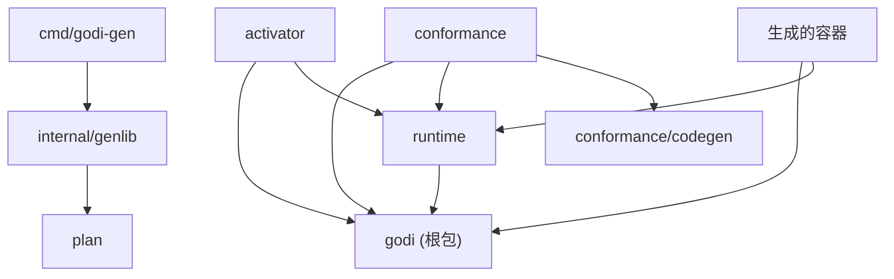

# godi 项目概览

## 简介

godi 是一个面向 Go 的依赖注入（DI）框架，把 .NET 的
`Microsoft.Extensions.DependencyInjection` 语义系统性地移植到 Go 语言上。它以
.NET 10（基线 v10.0.9）的 DI 行为契约为蓝本，让 Go 开发者获得与之等价的生命周期
管理、作用域、键控服务、多实现枚举、开放泛型（以显式封闭注册替代）与构建期校验能力。

godi 的核心价值主张有三点：

1. **零反射式主路径**——主架构采用 B2 codegen（代码生成）+ 直接装配。生成的容器
   用类型化字段存放实例、用 `Ctor` 直接调用构造，主路径不出现任何 `reflect.New` /
   `reflect.Value.Call`（AD-13）。反射仅作为查询派发键（Tier B）或退化到独立的
   `activator` 包（Tier C）。
2. **双 Provider 差分等价**——同一份 DSL 注册源同时派生出「运行时反射 Provider」
   与「代码生成 Provider」，二者在同一契约下必须产生逐位等价的可观察行为（AD-14 /
   AD-15），互为验证。
3. **静态标记 DSL**——注册用的 DSL 函数是纯静态标记（AD-7）。generator 通过
   `go/packages` + `go/types` 静态分析读取注册调用的类型实参，从不执行用户代码。

## 技术栈

| 组件 | 版本 | 说明 |
| --- | --- | --- |
| Go | 1.27（工具链锁定 go 1.27.0） | 启用方法级类型参数（AD-5），支撑 `provider.Get[T]()` 泛型方法 API |
| golang.org/x/tools | v0.49.0 | 唯一外部依赖，提供 `go/packages`，供 generator 静态分析（NFR6） |
| golang.org/x/mod | v0.39.0 | x/tools 的间接依赖 |
| golang.org/x/sync | v0.22.0 | x/tools 的间接依赖 |
| .NET DI（移植基线） | 10 / v10.0.9 | 行为契约与验收口径的蓝本 |
| mise | — | 项目级工具链锁定（`mise.toml`） |

## 九大能力

| 能力 | 名称 | 简述 |
| --- | --- | --- |
| CAP-1 | 构造注入与歧义构造选择 | 构造器发现与依赖注入；best-match 构造选择仅在 activator |
| CAP-2 | 三类生命周期 | 单例（Singleton）/作用域（Scoped）/瞬态（Transient） |
| CAP-3 | 作用域与释放 | 子作用域创建、Disposable LIFO 释放 |
| CAP-4 | 多实现解析 | `IEnumerable[T]` 等价：`GetServices[T]` 按注册顺序枚举 |
| CAP-5 | 键控服务解析 | KeyedServices，key 类型 = any，对齐 .NET 8+ |
| CAP-6 | 类型化解析与 IsService | `GetService<T>` 等扩展、`IsService` 查询、`Get[T]()` 人体工学 |
| CAP-7 | 开放泛型 | 以显式封闭注册替代（无 `MakeGenericType`），generator 封闭物化 |
| CAP-8 | 循环依赖检测 | 构建期检出依赖环 |
| CAP-9 | 构建期校验 | 缺失依赖 / 捕获依赖左移到生成期 |

## 包结构

模块路径：`github.com/gonewx/godi`

| 包 | 职责 |
| --- | --- |
| `godi`（根包） | 公开 DSL 标记（`AddSingleton` 等）、`Provider`/`Scope` 契约、`Get[T]` 等自由泛型函数、`AnyKey` 哨兵、`AsyncDisposable` |
| `plan` | 注册计划模型（`Registry`/`Service`/`Lifetime`）与校验门禁 `Validate()` |
| `internal/genlib` | 唯一产码路径 `Generate()`；输入 `plan.Registry`，输出格式化 Go 源码 |
| `cmd/godi-gen` | generator CLI：`go/packages` 加载 → `go/types` 读类型 → 构建 registry → 产码 |
| `runtime` | 运行时反射 Provider（Builder → Build → root/scope）、Disposer |
| `activator` | 唯一反射构造点 `CreateInstance[T]`（Tier C，best-match 构造选择） |
| `conformance` | 双 Provider 一致性测试套件、harness、差分等价断言 |

## 包依赖图



生成的容器只依赖 `godi` 与 `runtime`，**永不依赖 generator**——产码是单向的（AD-2）。

## DSL 注册形态速览

DSL 提供两种注册形态，交叉三种生命周期与无键/键控：

- **形态 A**（`Add{Lifetime}`）：按 `New{Impl}` 严格命名约定发现构造器，直接装配
  （AD-8，主路径）。
- **形态 B**（`Add{Lifetime}Factory`）：显式传入 `func(Provider) I` 工厂，是没有
  `New{Impl}` 构造器时的逃生舱（AD-8）。Go 不支持泛型函数重载，故形态 B 不能与形态
  A 同名（AD / D-4）。

| | 无键 · 形态 A | 无键 · 形态 B | 键控 · 形态 A | 键控 · 形态 B |
| --- | --- | --- | --- | --- |
| Singleton | `AddSingleton[I,Impl]` | `AddSingletonFactory[I]` | `AddKeyedSingleton[I,Impl]` | `AddKeyedSingletonFactory[I]` |
| Scoped | `AddScoped[I,Impl]` | `AddScopedFactory[I]` | `AddKeyedScoped[I,Impl]` | `AddKeyedScopedFactory[I]` |
| Transient | `AddTransient[I,Impl]` | `AddTransientFactory[I]` | `AddKeyedTransient[I,Impl]` | `AddKeyedTransientFactory[I]` |

## Provider 接口与自由泛型函数

`Provider` 接口刻意**非泛型**（Go 接口方法不可声明类型参数，AD-5），固定 7 个方法
（AD-16）：

| 方法 | 语义 |
| --- | --- |
| `GetService(t reflect.Type) any` | 未命中返 `nil`，从不 panic |
| `IsService(t reflect.Type) bool` | 是否可解析（纯查询） |
| `IsKeyedService(t reflect.Type, key any) bool` | 键控可解析查询；`nil` 键等价 `IsService`；`AnyKey` 返 `false` 不 panic |
| `GetKeyedService(t reflect.Type, key any) any` | 未命中返 `nil`；`nil` 键路由无键；`AnyKey` panic |
| `GetKeyedServices(t reflect.Type, key any) []any` | 按注册顺序返回；`AnyKey` 返回全部 keyed |
| `CreateScope() Scope` | 开子作用域（Scope 即 Provider） |
| `Close() error` | 幂等释放 |

人体工学的类型化解析作为自由泛型函数存在（AD-5），共 6 个：

| 函数 | 语义 |
| --- | --- |
| `Get[T](p) (T, bool)` | 命中返 `(值, true)`，未命中返 `(零值, false)`，不 panic |
| `GetRequired[T](p) T` | 命中返值，未命中 panic |
| `GetServices[T](p) []T` | 按注册顺序返回全部实现（未注册返空非 nil 切片） |
| `GetKeyed[T](p, key) (T, bool)` | 键控版 `Get` |
| `GetRequiredKeyed[T](p, key) T` | 键控版 `GetRequired` |
| `GetKeyedServices[T](p, key) []T` | 键控版 `GetServices` |

**AnyKey 三态**（查询哨兵，AD-17）：`GetKeyedService(AnyKey)` panic；
`GetKeyedServices(AnyKey)` 返回全部 keyed；`IsKeyedService(AnyKey)` 返回 `false`。

## Quick Start

在注册文件里用 DSL 标记声明服务（generator 只静态读取，从不执行用户代码）：

```go
package myapp

import "github.com/gonewx/godi"

//go:generate godi-gen -pkg myapp -out container_gen.go .

func register() {
    var r godi.Registry

    godi.AddSingleton[Clock, SystemClock](&r)     // 形态 A：发现 NewSystemClock
    godi.AddScoped[Repo, SQLRepo](&r)             // 形态 A：装配 NewSQLRepo(Clock)
    godi.AddTransientFactory[Logger](&r, func(p godi.Provider) Logger {
        return NewLogger(godi.GetRequired[Clock](p)) // 形态 B：工厂逃生舱
    })
}
```

运行 `go generate ./...` 产出 `container_gen.go` 后，即可从生成的容器解析服务：

```go
root, err := myapp.NewRoot()
if err != nil {
    return err
}
defer root.Close()

clock := godi.GetRequired[Clock](root)   // 单例
scope := root.CreateScope()
defer scope.Close()
repo := godi.GetRequired[Repo](scope)    // 作用域内实例
```
